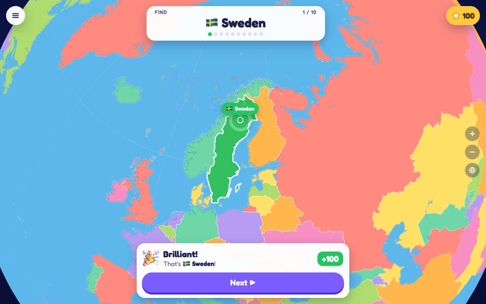

# Kinder Geo

A geography game for kids. The game names a place, and the player finds it on
a colourful map that has no names on it. It runs in any modern browser, on
phones, tablets and computers.

**Play it:** <https://kindergeo.com> (also <https://playkindermap.web.app>)

**About it:** <https://quickdahuk.github.io/kindergeo/> (the story and screenshots)



## How it started

Kinder Geo is a vibe-coded app I made for my kid. It started with a globe:
my kid would bring it to me and ask me to call out a country, so he could find
it. Then he came up with the idea of points. I turned that whole
back-and-forth into this game, together with him. Later, his friends and
cousins asked for other countries too, which grew the game to the states,
provinces and districts of eight countries (the Start menu's second page).

| | |
|---|---|
| What it is | A static web page: HTML, CSS and plain JavaScript modules. No build step, no framework, no server code, no accounts. |
| Map engine | [MapLibre GL JS](https://maplibre.org/) 6.15, kept in `vendor/` |
| Map data | JSON in `data/`, made ahead of time by the Python scripts in `tools/` |
| Hosting | Firebase Hosting, project `playkindermap` |
| Domain | `kindergeo.com`, registered with Squarespace, pointed at Firebase |
| Code | <https://github.com/quickdahuk/kindergeo> |
| Project page | <https://quickdahuk.github.io/kindergeo/>, on GitHub Pages from `docs/` |
| How the code works | [ARCHITECTURE.md](ARCHITECTURE.md) |
| Licence | [MIT](LICENSE) (bundled map data, map engine and font keep their own; see the end) |
| Notes for AI agents | [AGENTS.md](AGENTS.md) |

The game was first called **Country Quest**. Players only see "Kinder Geo",
but some names inside the code keep the old one: `window.countryQuest` (the
hook the tests use), the `cq.` keys in `localStorage` (players' saved
settings and best scores) and comments. Leave them, or a rename would wipe
everyone's saved settings and break the tests.

## The game

| Pick | Points |
|---|---|
| The right place | 100 |
| A neighbour | 50 |
| One on the same continent (or in the same part of the country) | 25 |
| Anything else | 0 |

A game is 10 rounds, so 1000 points is a perfect score.

- **Explore mode** (the opening page): a slowly turning globe that shows day
  and night as they are right now. Tap a place for a card with its flag,
  continent, population, capital, languages, a fun fact and a **Learn more**
  link to its Wikipedia page. Touching the globe stops it; the globe button
  goes back to the start.
- **The Start menu** has two pages, switched by two small dots on its right
  edge:
  - **Page 1:** the Whole World, one continent or the **US States**, at
    *Easy*, *Medium* or *Hard*.
  - **Page 2, "Inside a country"** (for keen players): the provinces, states,
    regions or districts of **China** (33), **India** (36), **Canada** (13),
    **France** (13 regions), the **United Kingdom** (England's 9 regions,
    Scotland, Wales and Northern Ireland), **Germany** (16), **Australia** (8)
    and **Bangladesh** (all 64 districts). No levels: 10 places a game
    (Australia: all 8). While one of these is played or explored, the other
    countries and the sea are muted (half as colourful, at 30% of their
    brightness), so the country stands out.
- **The quiz:** tap a place, press **Check**. The map then flies to the answer;
  **Next** flies back. **Show me** reveals the answer for 0 points. The quiz
  map never shows names or the night shadow.
- **Show names** (in the menu) turns the map into an atlas while exploring.
- **Tiny places** (Vatican City, Singapore, Delhi, Bremen, …) get a tappable
  dot once zoomed in, and taps have a little slack.
- **Phones:** every screen fits without scrolling, upright or sideways. The
  game can be added to the home screen. There is no sound, no timer and no
  ads.

It needs a browser with WebGL 2: Safari on iOS 15+, or Chrome, Firefox, Edge
or Samsung Internet from the last few years.

## Run it on your computer

Browsers won't run JavaScript modules from `file://`, so it needs a small web
server:

```sh
python3 tools/serve.py          # http://localhost:8000
python3 tools/serve.py 8642     # or another port
```

It also prints a `http://<your-ip>:<port>/` address for phones and tablets on
the same network. Edit the files, reload the page: there is nothing to build.

## What's where

```
index.html            the page: every screen and button, hidden until needed
css/style.css         all styling, for every screen size
js/main.js            the app: screens, the Start menu, rounds, cards, storage
js/map.js             the map: layers, globe/flat switch, tapping, camera, day and night
js/game.js            the rules: points, regions, levels, choosing questions
js/data.js            loads data/*.json and decodes it for MapLibre
js/flags.js, js/confetti.js
data/                 map data made by tools/ (world, countries, US states, provinces), and the hand-written facts.json
vendor/maplibre-gl/   MapLibre GL JS 6.15.0 (BSD-3-Clause)
assets/               icons and the Fredoka font (SIL OFL)
tools/                data builds, local server, automated checks, Firebase copy, Claude artifact build
tests/                unit tests (tests/unit.html, opened through the server)
firebase/             Firebase Hosting settings (firebase.json, .firebaserc); public/ is a generated copy, not in git
ARCHITECTURE.md       how it all works, the design rules, and how to change things safely
docs/                 the project page on GitHub Pages: docs/index.html, screenshots in docs/images/
AGENTS.md, CLAUDE.md  short working notes for AI coding agents
LICENSE               MIT licence for the code
```

## The map data

The data in `data/` is committed, so the game runs without building it. To
rebuild it (for example after changing a build script), run the scripts in
this order:

```sh
python3 tools/build_data.py        # data/world.json, data/countries.json
python3 tools/build_states.py      # data/us-states.json
python3 tools/build_provinces.py   # data/provinces.json (needs Node.js, see below)
```

Each takes `--report` to print every neighbour list. The sources are
downloaded once to `.cache/`. Afterwards, read the printed summary, run the
unit tests, and look at the map.

- **Countries** (`build_data.py`): [Natural Earth](https://www.naturalearthdata.com/)
  1:50m countries. 197 countries (the 193 UN members plus Vatican City,
  Palestine, Kosovo and Taiwan); the quiz asks the 169 that are big enough to
  see or have at least a million people. Territories such as Greenland can be
  tapped but are never asked. Neighbours share a border or are within 150 km
  across the sea; continents follow the UN regions (the Americas split in
  two). Fixes to the source match UN-recognised borders (Crimea is part of
  Ukraine, for example). Hand-made lists are at the top of the script.
- **US states** (`build_states.py`): Natural Earth's 1:50m states. The 50
  states and Washington, D.C. (shown, never asked), in the Census Bureau's
  four regions.
- **Provinces** (`build_provinces.py`): Natural Earth's 1:10m states and
  provinces; France's départements merged into regions and the UK's councils
  into regions. Bangladesh's 64 districts come from
  [geoBoundaries](https://www.geoboundaries.org/), with the government's
  spellings (Bogura, Barishal, Cumilla, Chattogram, Jashore) and 2022 census
  populations. Each country's places are cut to fit that country's outline on
  the world map exactly. The merging and simplifying uses
  [mapshaper](https://github.com/mbloch/mapshaper) through `npx`, so this one
  script needs **Node.js**; the others need only Python 3.
- **Facts** (`data/facts.json`): written by hand (checked October 2026):
  capital, languages and a fun fact for every country, and capital, nickname,
  population and fun fact for every US state. Provinces have none yet.

## Deploying

The live site is on **Firebase Hosting**, project **`playkindermap`**
([console](https://console.firebase.google.com/project/playkindermap/overview)),
owned by the project owner's Google account. Deploys use the Firebase CLI
through `npx`, so only Node.js is needed.

```sh
npx firebase-tools@latest login     # once per computer: signs in with the owner's Google account

python3 tools/build_firebase.py     # copies the 23 site files into firebase/public/
cd firebase
npx firebase-tools@latest deploy --only hosting --project playkindermap
```

- Always run `tools/build_firebase.py` first: `firebase/public/` is a copy and
  doesn't follow changes to the game. Never edit it by hand; it isn't in git.
- Don't run `firebase init hosting`: it would overwrite `firebase.json`.
- `firebase.json` sends `Cache-Control: no-cache`, so players get new files
  straight after a deploy. Firebase compresses files itself.
- A test address that expires after 7 days:
  `npx firebase-tools@latest hosting:channel:deploy try-out --project playkindermap`.
- To check a deploy, compare a live file with the copy:

  ```sh
  curl -s https://kindergeo.com/js/map.js | shasum
  shasum < firebase/public/js/map.js
  ```

**The domain.** `kindergeo.com` is registered with Squarespace Domains, and
its DNS is managed there. It points at Firebase with two records: an `A`
record for `@` → `199.36.158.100`, and a `TXT` record for `@` →
`hosting-site=playkindermap`. Firebase issues the HTTPS certificate itself.
`www.kindergeo.com` isn't set up yet (see open items).

**Other hosts.** Any static host works (GitHub Pages, Netlify, nginx, …):
upload `index.html`, `manifest.webmanifest`, `css/`, `js/`, `data/`,
`vendor/` and `assets/`. The server must send `.js`/`.mjs` as JavaScript,
should compress text, and should send `Cache-Control: no-cache`. See
[ARCHITECTURE.md → Deploying](ARCHITECTURE.md#deploying).

**The project page** (<https://quickdahuk.github.io/kindergeo/>) is GitHub
Pages, built from the `docs/` folder of the `main` branch: push a change to
`docs/` and it goes live within a minute or two. It's a single
`docs/index.html` with its own copy of the font, and screenshots in
`docs/images/` taken from the live game with Playwright (1280 × 800 for
desktop, 390 × 844 at 2× for phones, JPEG). It isn't part of the game's
Firebase deploy. When the game's look changes, retake the screenshots.

**Claude artifact version.** `python3 tools/build_artifact.py` builds a
version for publishing as a Claude artifact into `.cache/artifact/` (it loads
MapLibre and the font from CDNs, which that host requires). It isn't used for
the live site.

## Testing

- **Unit tests** (rules and data, 50 tests): start `tools/serve.py` and open
  <http://localhost:8000/tests/unit.html>.
- **Automated checks** (`tools/check.py`, about 370 checks, 10–15 minutes):
  runs the unit tests, then plays the game in a headless browser on a
  desktop, a phone and a phone held sideways. It covers the opening globe,
  flicking, whole games with every outcome, Explore mode and cards, the US
  States, the Start menu's second page (a Bangladesh game), and pixel checks
  of the globe unrolling. Screenshots go to `test-results/`.

  ```sh
  python3 -m venv .venv && .venv/bin/pip install playwright
  .venv/bin/python -m playwright install chromium --only-shell
  .venv/bin/python tools/check.py
  ```

  It draws with software rendering, so it is slow and needs no GPU. On a busy
  or slow computer, the check "the opening globe turns" can fail (the globe
  turns less than expected in 0.8 s); that one is about the computer, not the
  game, if the rest pass.

## Changing things

Read [ARCHITECTURE.md](ARCHITECTURE.md) first: it explains the design rules
(no names on the quiz map, nothing too small to tap, screens fit on phones,
plain words for young children, facts must be true) and how to make common
changes. The settings most often changed:

| What | Where |
|---|---|
| Points, rounds, levels, which tiny countries are asked | `js/game.js`: `POINTS`, `ROUNDS`, `LEVELS`, `TINY_MIN_POP` |
| The countries on the menu's second page | `js/game.js`: `COUNTRY_REGIONS`, and `tools/build_provinces.py` |
| How muted the other countries and the sea are in province games | `js/map.js`: `MUTED_SATURATION` (0.5), `MUTED_BRIGHTNESS` (0.3) |
| Map colours | `js/map.js`: `PALETTE`, `OCEAN`, `RESULT_COLORS` |
| A region's starting view | `js/map.js`: `REGION_BOUNDS` (a country's provinces fit by themselves; Canada has its own box) |
| The night shadow | `js/map.js`: the `NIGHT_*` constants |
| Facts on the cards | `data/facts.json` |
| Wikipedia links | `js/main.js`: `WIKI_TITLES`; for provinces, `WIKI` in `tools/build_provinces.py` |
| Words players read | `js/main.js` and `index.html` |

To add a country to the menu's second page, see
[ARCHITECTURE.md → Adding a country](ARCHITECTURE.md#adding-a-country-to-the-menus-second-page).

## Status

As of October 2026:

- **Live** on kindergeo.com. Deploys are done by hand (see
  [Deploying](#deploying)), from the `main` branch of this repository.
- **Recent work:**
  - the name Kinder Geo, and the custom domain;
  - "Learn more" Wikipedia links on every card;
  - the Start menu's second page with 8 countries;
  - the muted look of the other countries in province games;
  - a fix for the globe sitting off-centre on wide screens (over 1400 px).
- **Open items:**
  - `www.kindergeo.com` doesn't work yet. Add it in Firebase Hosting →
    *Add custom domain* (redirect to `kindergeo.com`), then add the record
    Firebase shows in Squarespace's DNS settings.
  - The Bangladesh district map is CC BY, which asks for credit. The credit is
    in this README but not in the game yet (the owner chose to leave it for
    now).
  - Province cards have no capital or fun fact yet (Bangladesh's districts
    show their population).
  - Known gaps: flag emoji don't show on Windows, English only, no offline
    play. Disputed borders follow one point of view (see ARCHITECTURE.md).

## Privacy

No accounts, cookies, analytics or ads, and the page loads nothing from other
sites. Settings and best scores stay in the browser's `localStorage`. The
"Learn more" links open Wikipedia only when tapped. Keep it this way: schools
look for it.

## Licence and credits

The code is under the [MIT licence](LICENSE). The parts it bundles keep their
own licences:

- Map data: [Natural Earth](https://www.naturalearthdata.com/) (public domain)
- Districts of Bangladesh: Bangladesh Bureau of Statistics and OCHA ROAP, via
  [geoBoundaries](https://www.geoboundaries.org/) (CC BY 3.0 IGO); populations
  from the 2022 census
- Map engine: MapLibre GL JS (BSD 3-Clause, see `vendor/maplibre-gl/LICENSE.txt`)
- Font: Fredoka (SIL Open Font License, see `assets/fonts/OFL.txt`)
